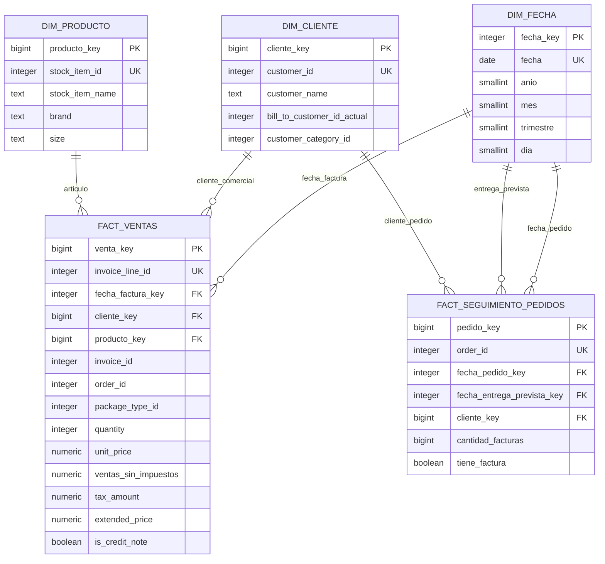

# Modelo dimensional de ventas: diseño conceptual y lógico

## Estado, evidencia y límites de esta etapa

Se diseña una estrella de ventas y un proceso independiente de seguimiento de pedidos. **No se han creado tablas físicas del DWH, ejecutado DDL PostgreSQL ni conectado Supabase.** No se implementan READY, staging, cargas, incrementalidad, autenticación, dashboards ni IA.

Se revisaron la exploración (`02_exploracion_fuente.md`), los seis KPI (`03_definicion_kpis.md`), las reglas de calidad (`04_reglas_calidad_datos.md`), las guías RAW/VALIDATED/completo (06–08), `etl/esquema_raw.json`, `extraer_raw.py`, `validar_raw.py` y la conexión compartida. Las anotaciones históricas de exploración que aún hablan de fórmulas candidatas se interpretan junto a los resultados posteriores de 03 y 08.

La evidencia local utiliza la extracción completa **20261115T044925Z-474e2802f9394e44855c01a4fc87e9e6**, previamente validada, con 373260 registros entre las cinco tablas. Su lectura original no fue una instantánea transaccional: conteos coincidentes no prueban consistencia ante escrituras concurrentes.

El borrador PostgreSQL está en `database/data-warehouse/01_modelo_logico.sql`, **completamente comentado para impedir ejecución accidental**. No es una migración ni un esquema desplegado. Las consultas de análisis local están en `02_validacion_extraccion.sql`; su dialecto es SQLite y no debe confundirse con el DDL PostgreSQL.

## Estrella y granos

**Grano de fact_ventas: una fila por Sales.InvoiceLines.InvoiceLineID**, asociada a su cabecera Invoices por InvoiceID. No agrupar ni deduplicar por factura/producto: un artículo puede aparecer en varias líneas del mismo documento. Tampoco unir líneas de pedido con líneas de factura para obtener ventas.

| Entidad | Grano | Clave primaria y clave de negocio |
| --- | --- | --- |
| dim_fecha | Una fecha calendario, más miembro desconocido | PK fecha_key integer, código determinista YYYYMMDD; negocio fecha date UNIQUE. Excepción técnica: clave 0. |
| dim_cliente | Un cliente actual de Sales.Customers | PK sustituta cliente_key bigint identity; negocio customer_id integer UNIQUE. |
| dim_producto | Un artículo actual de Warehouse.StockItems | PK sustituta producto_key bigint identity; negocio stock_item_id integer UNIQUE. |
| fact_ventas | Una línea de factura | PK técnica venta_key bigint identity; invoice_line_id integer NOT NULL UNIQUE conserva el grano de negocio. |
| fact_seguimiento_pedidos | Un pedido en el estado observado de la extracción | PK técnica pedido_key bigint identity; order_id integer NOT NULL UNIQUE. No es un histórico de snapshots apilados. |

Las PK técnicas de hechos facilitan referencias futuras, pero la unicidad de las claves de negocio es la que evita duplicar documentos o líneas al repetir una futura carga. No se incluye raw_run_id en la unicidad de InvoiceLineID u OrderID: hacerlo permitiría duplicar ventas/pedidos al repetir extracciones.



No hay enlace entre hechos en el esquema. Las dimensiones fecha y cliente son conformadas para análisis de ambos procesos. Si se comparan ventas y pedidos, agregar cada hecho por separado al grano común de fecha/cliente y luego combinar sus agregados; nunca sumar ventas después de unir directamente ambos hechos por OrderID.

## Factura y pedido como identificadores degenerados

`fact_ventas.invoice_id` copia Invoices.InvoiceID/InvoiceLines.InvoiceID. Es un identificador degenerado para trazabilidad, agrupación y COUNT(DISTINCT invoice_id), **no es único en el hecho**. No se crea dim_factura: para los KPI actuales bastan fecha, cliente, indicador de crédito y el identificador del documento.

`fact_ventas.order_id` copia Invoices.OrderID y conserva su nulabilidad. Es otro identificador degenerado, sin dimensión pedido y sin FK hacia fact_seguimiento_pedidos. No se asume una sola factura por pedido: la muestra completa tiene cero o una, pero la relación no impone esa regla universal. `backorder_order_id` se conserva como identificador opcional en seguimiento, sin inventar un estado de negocio.

Los atributos extensos de cabecera, contactos, entrega y comentarios permanecen en RAW; si hubiera un requisito analítico futuro, se evaluaría un proceso de facturación al grano de cabecera o atributos adicionales antes de crear otra dimensión. No repetir importes de cabecera en cada línea.

## Medidas, precisión y seis KPI

| Medida del hecho | Origen / cálculo | PostgreSQL sugerido | Agregación |
| --- | --- | --- | --- |
| quantity | InvoiceLines.Quantity | integer | SUM, solo entre presentaciones compatibles. |
| unit_price | InvoiceLines.UnitPrice | numeric(18,2) | No aditiva; no SUM de precios. |
| ventas_sin_impuestos | Quantity × UnitPrice | numeric(28,2), expresión generada en el borrador | SUM. La precisión ampliada admite el producto del int y el decimal originales. |
| tax_rate | InvoiceLines.TaxRate | numeric(18,3) | No aditiva; no SUM ni promedio sin ponderación definida. |
| tax_amount | InvoiceLines.TaxAmount | numeric(18,2) | SUM, impuesto registrado. |
| extended_price | InvoiceLines.ExtendedPrice | numeric(18,2) | SUM, total con impuestos registrado. |

La precisión decimal debe mantenerse desde CSV con Decimal hasta numeric. No usar float ni el tipo money. PostgreSQL documenta numeric como tipo exacto apropiado para importes; la identidad no sustituye una restricción PK/UNIQUE. [Tipos numéricos](https://www.postgresql.org/docs/current/datatype-numeric.html), [columnas identity](https://www.postgresql.org/docs/current/ddl-identity-columns.html).

No hay columna de moneda verificada en las cinco tablas. No se asigna USD, HNL, símbolo monetario ni una dimensión moneda ficticia, ni se implementa conversión. Los importes reproducen los KPI de la fuente; confirmar la moneda y la homogeneidad monetaria antes de certificar interpretación financiera.

La cantidad global observada sirve como control técnico, **no acredita una unidad homogénea**. Conservar `package_type_id` de cada línea y agrupar productos por StockItemID y ese identificador. No sustituirlo por UnitPackageID/OuterPackageID actuales del maestro ni convertir cajas a unidades sin reglas verificadas.

1. **Ventas totales:** SUM(ventas_sin_impuestos), SUM(tax_amount) y SUM(extended_price), con `is_credit_note=false`. La comprobación por línea sigue siendo ABS(ExtendedPrice − (Quantity × UnitPrice + TaxAmount)) ≤ 0.01. Es una tolerancia provisional, no prueba de igualdad exacta ni validación detallada de TaxRate. El borrador no la convierte en CHECK permanente.
2. **Facturas emitidas:** COUNT(DISTINCT invoice_id) con el mismo filtro. No sumar esos conteos entre productos/clientes porque pueden repetirse documentos entre grupos. En esta extracción todas las cabeceras tienen líneas y el conteo reproduce 70510. Si en otra carga existen facturas sin líneas, el hecho de ventas no permite contar todas las cabeceras: se necesitaría un control/reporte de Invoices o un hecho de cabecera separado, no inventar una línea de importe cero.
3. **Top 10 productos:** SUM(quantity) por producto y package_type_id; desempate StockItemID/PackageTypeID.
4. **Top 10 clientes:** SUM(ventas_sin_impuestos) por el cliente comercial de la factura; desempate CustomerID.
5. **Ventas mensuales:** SUM(ventas_sin_impuestos) por año/mes de la fecha de factura, sin sumar atributos del maestro ni fechas de pedido.
6. **Pedidos sin factura:** estructura separada descrita a continuación; no inferirlos a partir de ausencia en fact_ventas.

El hecho se diseña para conservar todas las líneas y `is_credit_note`; los seis KPI actuales usan sus filtros documentados. No eliminar notas de crédito futuras ni invertir automáticamente signos. En el estado observado todas las facturas son ordinarias. La semántica neta de créditos sigue pendiente.

UnitPrice admite NULL en SQL Server. RAW lo conserva; el validador actual rechaza esas líneas por MONETARIO_INCOMPLETO. El diseño propone NOT NULL en el hecho certificado, sin convertir NULL a cero. Antes de cualquier carga se debe explicar toda diferencia entre líneas originales, cuarentena y líneas certificadas. No descartar silenciosamente una línea para hacer coincidir totales.

## Cliente comercial, maestro actual e historia

La FK cliente_key de fact_ventas se resuelve con **Invoices.CustomerID**, no con Orders.CustomerID ni BillToCustomerID. `bill_to_customer_id_factura` conserva el valor original de Invoices.BillToCustomerID como trazabilidad del rol de facturación. En la extracción hay **44245 facturas con cliente comercial distinto del cliente de facturación**.

`dim_cliente.bill_to_customer_id_actual` procede de Customers.BillToCustomerID y describe el maestro actual; no sustituye el BillTo registrado en una factura pasada. Un análisis futuro del cliente facturado podría reutilizar dim_cliente con otra FK de rol; no requiere otra dimensión con datos duplicados. Esa segunda FK no se incluye aún en el diseño mínimo.

Cliente y producto se proponen inicialmente como **SCD tipo 1** (una versión actual por clave de negocio). Customers/StockItems incluyen ValidFrom y ValidTo, pero solo se extrajeron sus tablas actuales, no sus históricos temporales. No se puede reconstruir qué nombre/categoría/precio de catálogo tenía cada entidad en 2013. Una futura SCD tipo 2 necesitaría históricos o capturas y reglas de vigencia/solapamiento; cambiaría la unicidad de las dimensiones y su resolución temporal.

Las medidas de ventas siempre usan la línea original: nunca el UnitPrice o TaxRate actual de StockItems. Tampoco se usa el descuento actual de Customers para reconstruir ventas históricas.

## Seguimiento de pedidos sin mezclar granos

`fact_seguimiento_pedidos` incluye **todos** los Orders, no solo los no facturados, para conservar el denominador del KPI. Su cliente procede de Orders.CustomerID. Fecha principal: OrderDate; ExpectedDeliveryDate usa dim_fecha en otro rol. Cantidad_facturas es COUNT de cabeceras de Invoices con el mismo OrderID, incluyendo cualquier IsCreditNote conforme al criterio original; tiene_factura se deriva como cantidad_facturas > 0.

Fórmula: `100.0 × COUNT(*) FILTER (WHERE NOT tiene_factura) / NULLIF(COUNT(*),0)`, redondeada a dos decimales para presentación. No sumar cantidad_facturas para contar pedidos facturados; un pedido con varias facturas sigue siendo un pedido. No usar existencia de líneas: una cabecera sin líneas también cuenta como factura vinculada.

No hay importes de ventas en esta estructura ni cantidades pedidas, porque Sales.OrderLines no fue extraída. Los pedidos sin factura no se etiquetan como cancelados, pendientes ni incumplidos. La existencia se evalúa sobre la extracción completa observada, no a la fecha histórica de OrderDate.

El diseño inicial representa un solo estado por OrderID, con raw_run_id como procedencia. No define cargas ni conserva varios snapshots por repetición. Si se requiere evolución histórica del estado, se diseñará otro grano explícito (OrderID, fecha de snapshot), con reglas de no aditividad entre snapshots.

## Cobertura real y diccionario de atributos

| Entidad | Atributos elegidos y origen real | Fuera del alcance actual |
| --- | --- | --- |
| dim_fecha | fecha derivada de InvoiceDate, OrderDate y ExpectedDeliveryDate; año, mes, trimestre y día calculados del calendario. Cubrir todas las fechas referenciadas, incluso entregas previstas posteriores al rango de facturación. | Festivos, calendarios fiscales y cierres comerciales sin fuente/regla aprobada. |
| dim_cliente | customer_id ← CustomerID; customer_name ← CustomerName; bill_to_customer_id_actual ← BillToCustomerID; customer_category_id ← CustomerCategoryID; buying_group_id ← BuyingGroupID; account_opened_date ← AccountOpenedDate; payment_days ← PaymentDays; is_on_credit_hold ← IsOnCreditHold; delivery_postal_code ← DeliveryPostalCode. | Nombres de categoría/grupo, ciudad, provincia o país: catálogos no extraídos. Los IDs disponibles no permiten inventar etiquetas. |
| dim_producto | stock_item_id ← StockItemID; stock_item_name ← StockItemName; brand ← Brand; size ← Size; barcode ← Barcode; supplier_id ← SupplierID; color_id ← ColorID; unit_package_id ← UnitPackageID; outer_package_id ← OuterPackageID; quantity_per_outer ← QuantityPerOuter; is_chiller_stock ← IsChillerStock. | Nombres de proveedor/color/tipo de paquete y conversiones de presentación: faltan catálogos y reglas. |
| fact_ventas | InvoiceLineID, InvoiceID, StockItemID, PackageTypeID, Quantity, UnitPrice, TaxRate, TaxAmount, ExtendedPrice de InvoiceLines; InvoiceDate, CustomerID, BillToCustomerID, OrderID e IsCreditNote de Invoices. FK sustitutas resueltas contra las dimensiones. | No usar TotalDryItems/TotalChillerItems de cabecera como medidas por línea. Description y LineProfit están disponibles, pero no se necesitan para estos seis KPI. |
| fact_seguimiento_pedidos | OrderID, CustomerID, OrderDate, ExpectedDeliveryDate y BackorderOrderID de Orders; conteo derivado de Invoices.OrderID. | Cantidades/importes pedidos, estado de cancelación o detalle de pedido: no inferirlos. |

`raw_run_id` y las claves sustitutas son atributos técnicos del diseño, no columnas comerciales supuestamente existentes en la fuente. Se conserva como identificador textual el run real; no requiere otra dimensión.

Los campos de contacto, direcciones completas, comentarios, fotos, campos personalizados y geography no son necesarios para estos KPI y quedan en RAW; no se convierten a atributos de negocio nuevos. Los catálogos de personas y métodos de entrega tampoco están extraídos. Los IDs de catálogo conservados en dimensiones son atributos, no FK hacia dimensiones inexistentes: la estrella no se convierte en un copo de nieve.

Correspondencias generales: int → integer; claves sustitutas → bigint identity; bit → boolean; nvarchar → text (evita confundir bytes UTF-16 con límites de caracteres); decimal(p,s) → numeric(p,s); date → date. Si en el futuro se incluye varbinary, correspondería bytea, no texto interpretado como imagen. Geography requeriría una decisión específica y no se presupone PostGIS.

No convertir silenciosamente datetime2(7) a timestamp(6): PostgreSQL conserva hasta microsegundos, mientras que la fuente tiene siete cifras. Los campos temporales de auditoría no están en este diseño mínimo; RAW conserva su texto exacto. Si se incorporan, preservar además la representación original o definir explícitamente una política de precisión, sin inventar zona horaria. [Tipos temporales PostgreSQL](https://www.postgresql.org/docs/current/datatype-datetime.html).

## Relaciones y desconocidos

Dimensiones con clave 0: cliente/producto con nombre `Desconocido` y clave de negocio NULL; fecha 0 con fecha y atributos NULL. Las secuencias normales comienzan en 1. Los CHECK del borrador permiten NULL en clave de negocio solo para el miembro 0. No se usan IDs comerciales ficticios ni fechas 1900/1970 para simular desconocidos. No se han insertado estos miembros.

Las FK del hecho son NOT NULL y apuntan a una dimensión existente; un miembro desconocido requiere asignación explícita en una futura política de carga, nunca DEFAULT 0 silencioso. En la extracción certificada, un vínculo requerido sin padre es un error que debe investigarse, no una razón para ocultarlo bajo desconocido. Si más adelante se admite un miembro provisional por dimensiones tardías, conservar la clave original y conciliar sus cantidades/importes por separado.

La nulabilidad original de Invoices.OrderID se conserva como NULL degenerado: no equivale a una dimensión desconocida ni se reemplaza por un pedido 0. No hay FK entre hechos ni un JOIN obligatorio hacia pedidos para incluir una venta.

## Comprobaciones ejecutadas sobre la extracción completa

`validar_modelo_local.py` carga **solo las columnas necesarias** en representaciones SQLite `:memory:`. Las entradas se leen por lotes con el lector CSV existente; los archivos y sus hashes no se modifican. Las consultas de `02_validacion_extraccion.sql` son SELECT; después de preparar las representaciones efímeras se habilita query_only. No hay base de datos persistida ni hechos/dimensiones cargados. Los sumatorios monetarios y su ordenación se calculan con Decimal, sin aproximación binaria.

Este análisis mantiene índices de claves y columnas seleccionadas en RAM: su memoria crece con la extracción, aunque la lectura de CSV sea por lotes. Es una herramienta de verificación de este volumen local, no otro motor ETL ni una garantía de memoria constante para fuentes arbitrariamente grandes. No se midió su pico de RAM. El extractor y validador existentes conservan sus respectivos mecanismos por lotes/SQLite en disco.

| Comprobación | Resultado real |
| --- | --- |
| PK de las cinco tablas | 0 nulos, 0 repeticiones. |
| Ocho enlaces con padres extraídos | 0 referencias huérfanas en todos. |
| Enlaces comprobados | InvoiceLines→Invoices; InvoiceLines→StockItems; Invoices.CustomerID→Customers; Invoices.BillToCustomerID→Customers; Invoices.OrderID→Orders; Orders.CustomerID→Customers; Orders.BackorderOrderID→Orders; Customers.BillToCustomerID→Customers. |
| NULL permitidos | Invoices.OrderID: 0; Orders.BackorderOrderID: 66057, sin tratarlos como huérfanos. |
| Grano antes/después del enlace cabecera–cliente–producto | 228265 filas y 228265 InvoiceLineID distintos en ambas etapas. |
| Facturas / sin líneas / créditos | 70510 / 0 / 0. |
| Ventas sin impuestos / impuestos / con impuestos | 172261341.20 / 25782098.25 / 198043439.45, iguales antes/después del enlace. |
| Fórmula monetaria | 0 diferencias > 0.01 o líneas incompletas. |
| Cantidad sumada sin conversión | 8950628; control técnico entre presentaciones, no unidad normalizada. |
| Producto líder | StockItemID 191, PackageTypeID 7, cantidad 207324. |
| Cliente líder comercial | CustomerID 149, ventas sin impuestos 381585.35. |
| Meses de facturación | 41, 2013-01 a 2016-05; suma 172261341.20. |
| Pedidos / con factura / sin factura / con varias | 73595 / 70510 / 3085 / 0; sin factura 4.19%. |
| Facturas anteriores al pedido | 0. |

El reporte local queda en `data/reports/modelo_dimensional_20261115T044925Z.json`, excluido de Git. Incluye hashes, resultados y los rankings calculados completos. Estas ocho comprobaciones **no certifican todas las FK de WideWorldImporters**: las que apuntan a catálogos no extraídos siguen pendientes.

Estas comprobaciones son independientes del validador RAW → VALIDATED: **no se activaron sus validaciones de FK**, ni para muestra ni para completo. El análisis dimensional exige manifiesto completo/terminado y no acepta las muestras independientes como prueba de integridad referencial.

## Conciliación exigida al futuro DWH

Antes de una futura carga: verificar manifiesto completo, esquema, hashes, PK y enlaces; resolver cada FK dimensional de manera uno-a-uno y explicar cualquier cuarentena/desconocido. Después de la carga se deberán ejecutar controles contra tablas reales, todavía inexistentes:

```sql
-- PostgreSQL futuro: referencia de comprobación, NO ejecutada.
SELECT COUNT(*) AS lineas, COUNT(DISTINCT invoice_line_id) AS claves,
       SUM(ventas_sin_impuestos) AS base,
       SUM(tax_amount) AS impuestos, SUM(extended_price) AS total,
       COUNT(DISTINCT invoice_id) AS facturas
FROM dwh.fact_ventas WHERE is_credit_note = false;

SELECT COUNT(*) AS pedidos,
       COUNT(*) FILTER (WHERE tiene_factura) AS con_factura,
       COUNT(*) FILTER (WHERE NOT tiene_factura) AS sin_factura,
       ROUND(100.0 * COUNT(*) FILTER (WHERE NOT tiene_factura)
             / NULLIF(COUNT(*),0), 2) AS porcentaje_sin_factura
FROM dwh.fact_seguimiento_pedidos;
```

Para esta extracción, el primer control debe conservar **228265** claves/líneas, los tres importes anteriores y **70510** facturas distintas; el segundo debe conservar **73595/70510/3085/4.19%**. Comparar también fila a fila por InvoiceLineID, suma por factura, cliente y mes y su total general, las 41 agrupaciones mensuales y los rankings por producto/presentación. Verificar que los JOIN a dimensiones no pierdan ni multipliquen líneas y que no existan FK dimensionales huérfanas, incluyendo el miembro desconocido si está autorizado. Estos valores son referencias de este run, no restricciones permanentes ni conteos universales.

Las comprobaciones posteriores al DWH están **pendientes** porque aún no hay tablas ni cargas. El análisis local demuestra conservación de los enlaces de fuente disponibles; no prueba una futura implementación ETL ni cierra toda la conciliación original SQL de la sección 7. La validación detallada de impuestos sigue pendiente.

## Reproducción y pruebas

Desde PowerShell en la raíz, usando el entorno existente, sin conexión a servicios:

```powershell
.\.venv\Scripts\python.exe -m unittest discover -s tests -p 'test_*.py' -v

.\.venv\Scripts\python.exe .\database\data-warehouse\validar_modelo_local.py --raw-dir '.\data\raw\20261115T044925Z-474e2802f9394e44855c01a4fc87e9e6'
$LASTEXITCODE
```

El análisis imprime JSON. Código 0: controles ejecutados correctos; 2: incumplimiento detectado; 1: error operativo. El reporte puede guardarse bajo `data/reports/` con `Set-Content -Encoding UTF8`. No ejecutar `01_modelo_logico.sql` ni pasar `02_validacion_extraccion.sql` a PostgreSQL: este último depende de las representaciones y funciones Decimal de la herramienta local.

Las pruebas nuevas usan datos ficticios y verifican dos líneas del mismo artículo/factura, roles de cliente distintos, duplicación de padres, huérfanos, OrderID NULL permitido, tolerancia decimal, importes incompletos, cobertura de columnas y rechazo del modo muestra. La suite completa tiene **34 pruebas aprobadas**, sin dependencias nuevas.

Pendientes: revisión de negocio de moneda, notas de crédito, unidades y tolerancia; historia de dimensiones; extracción de catálogos si se requieren etiquetas; diseño físico e índices; aprobación/ejecución del DDL; política de desconocidos tardíos; cargas y conciliación sobre un DWH real. Ninguna de esas etapas se implementa aquí.
